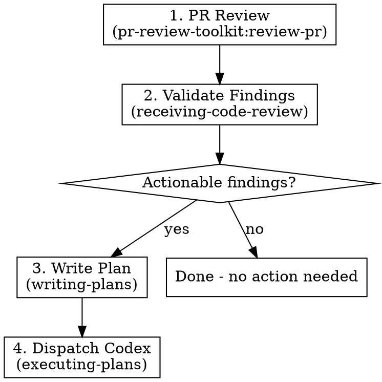

# Review and Execute

## Overview

Orchestrates a full review-to-fix cycle: PR review → validate findings → write remediation plan → dispatch Codex to execute.

**Announce at start:** "I'm using the review-and-execute skill to review and remediate changes."

## Strict Execution Protocol (non-negotiable)

<!-- juel:protocol v9 -->

**0. Harness check, before every other rule.** You are running in Codex when you have the `update_plan` tool and no `Skill` tool. Only then read `references/harness-codex.md`, resolved relative to this skill file's own location (`../../references/harness-codex.md`), and apply its construct map, corrected facts, dependency substitutions and degradation contract to every rule below and to every phase body in this skill. This single read is the one action permitted before rule 1's preflight, and only in that case. In every other case, Claude Code without the `TaskCreate` tool included, ignore that file entirely and continue to rule 1.

**1. Preflight, then task list, before anything else.** Before any other output and before any tool call, emit the Preflight block (below). If the preflight verdict is STOP, print the preflight block and **stop** — do not create tasks and do not begin work. Otherwise, before any other work, create one task per phase in this skill's `## Phases` list via `TaskCreate` — `subject` is the phase name, `activeForm` is its present-continuous form. This task list, rendered persistently by the harness, IS the checklist; nothing else satisfies this rule. This is not optional on re-invocation, on resume, or when the user says "just do it".
- **If `TaskCreate`/`TaskUpdate` are not in your tool list, or genuinely fail** — one attempted call returns an error; never assumed unavailable without checking the tool list — use `TodoWrite` when you have it (one todo per phase, the same names, updated at every transition), else an explicit numbered phase log, printed after every phase transition with the same one-line evidence rule 3 already requires. State the degradation once, in one line, before continuing. Never silently swap to prose without saying so.

**2. Phases run in order.** No skipping, reordering, or merging. A phase that does not apply is still announced, not dropped: mark its task `completed` via `TaskUpdate`, with the one-line evidence required by rule 3 stating the skip reason (e.g. "SKIPPED: <reason>") — the task list has no separate "skipped" status, so a skipped phase becomes `completed` too. Never begin phase N+1 before phase N's task is marked `completed`.

**3. Report after every phase.** Mark the phase's task `in_progress` via `TaskUpdate` when starting it, then `completed` via `TaskUpdate` when it finishes or is skipped — each transition accompanied by exactly one line of evidence (path written, command run, count found). Do not re-print the checklist as text; the task list is the persistent record and replaces that. Never claim progress in prose alone.

**4. `review-pr`'s agents run in PARALLEL and FOREGROUND; `code-simplifier` runs FOREGROUND; `codex exec` runs BACKGROUND, WATCHED, and WAITED-ON.** This overrides every other instruction in this file and in any skill invoked from it. Foreground/background is about whether the tool call blocks; watched is about whether output still streams somewhere the user can see it — these are different axes, and `codex exec` needs the second without the first. `review-pr`'s agents additionally need PARALLEL: dispatched together, not one at a time.
- `pr-review-toolkit:review-pr`'s agents MUST be dispatched in parallel: pass `all parallel`, or dispatch the agents together in ONE message. Its sequential default — one agent at a time — is the exact slowness this rule exists to prevent; requesting it, or omitting `all parallel`, is a violation.
- `pr-review-toolkit:review-pr` and `code-simplifier` are foreground-only. When your Agent tool has a `run_in_background` parameter, invoke both with `run_in_background: false` **explicitly** — the harness backgrounds subagents by default, so omitting the flag is a violation, not a neutral choice. Dispatching review-pr's agents in parallel does not relax this: each agent in that one message still carries its own explicit `run_in_background: false`. When your Agent tool has no such parameter, dispatch every one of them together in one message, wait for each one's completion, read each result in full, and check `ListAgents` before treating an idle agent as empty (rule 6); the phase never ends while one is still out. Never `&`. Never `run_in_background: true` for these two. Never "dispatch and continue".
- `codex exec` runs through the **Bash tool**, whose `timeout` parameter is capped at 600000ms (10 minutes). A real `codex exec` applying a plan routinely runs longer than that, so a foreground dispatch gets silently DETACHED by the harness at the cap regardless of this rule — nothing then watches it, nothing reads its output, and the skill would wrongly proceed as if the phase had ended. `review-pr` and `code-simplifier` run through the **Skill/Agent tool**, which carries no such cap — that is the entire reason only `codex exec` changes. Do not "fix" this back to foreground; the cap is a harness fact, not a preference.
- **Always dispatch `codex exec` with `run_in_background: true`** — not optional, not "if it looks long," always. Omitting the flag, or passing `false`, is a violation.
- **Never redirect a command's output to a log file.** No `> out.log`, no `| tee`, no writing output somewhere to read back later. This applies to all three, and is now MORE load-bearing for `codex exec`: backgrounded with no ceiling, the shell is the only place the user watches it work.
- For `review-pr` and `code-simplifier`: read the complete output and state the outcome — finding count, exit status, files changed — before marking the phase done. A summary may follow the raw output; it may never replace it.
- For `codex exec`: wait for it to exit before marking the phase done — backgrounding must never become fire-and-forget. Then state the outcome — exit status, files changed — not a transcript; the user already watched it stream in the shell, so its full output is never printed back into the conversation.
- **Never attach a `Monitor` or a polling loop to `codex exec`.** No `Monitor` armed on its output, no repeated reads of the `.output` file, no `tail -f`. Dispatch it backgrounded and wait for the completion notification — the user already watches it stream in their own shell, which is exactly why output must never be redirected; a watcher on top adds nothing, and a filter with no pattern for `Reading additional input from stdin...` will misread a stalled executor as healthy.
- Passing any of this into another session (a CMUX prompt, a nested `claude`) carries these rules with it — say so explicitly in that prompt string.

**5. Confirmation gates stack; they do not replace this.** Where this skill pauses between phases, the checklist report comes first, then the "Proceed to phase N+1?" question. A user's "yes" advances exactly one phase — it never authorizes skipping ahead or batching the remainder.

**6. `Idling` is a status, not a verdict — never read it as "returned nothing."** When a dispatched `pr-review-toolkit:review-pr` agent or `code-simplifier` shows `Idling` (or any non-streaming status) in the harness's agent view while its call is still in flight, that status alone never means the agent produced no output — `Idling` covers both "still working" and "finished, with a result already available but not yet consumed by this session" indistinguishably. Multi-agent dispatch is exactly where this bites: `pr-review-toolkit:review-pr`'s specialist agents run "all parallel" (rule 4), so several can sit at `Idling` simultaneously while one has already returned and the others haven't.
- **Before concluding a dispatch returned nothing, or re-dispatching it, check `ListAgents` for the agent by name.** If it's listed with a result available, read that result directly — do not wait further and do not re-dispatch a duplicate call.
- **Never re-dispatch `pr-review-toolkit:review-pr` or `code-simplifier` "to unstick it"** without first confirming via `ListAgents` that the original dispatch genuinely produced nothing — re-dispatching a call whose result already exists wastes a full review cycle and risks duplicate, conflicting findings.
- **Never go quiet past a check-in point with no status update.** If a dispatch has been running long enough that you would normally report progress, either report genuine progress or check `ListAgents` first — silently waiting while a subagent is actually done is the exact failure this rule exists to prevent.

## Preflight

| Dep | Type | H/S | Check | If missing |
|---|---|---|---|---|
| pr-review-toolkit | skill | SOFT | ships as a plugin dependency | fall back to `/review`, or an inline review of `git diff <base>...HEAD` |
| superpowers | skill | HARD | ships as a plugin dependency | STOP → `/plugin install superpowers@claude-plugins-official` |
| claude-plan-executor | skill | HARD | `sh <plugin root>/skills/ship-ticket/executor-check.sh <plugin root>` printing `ok` (`<plugin root>` is `${CLAUDE_PLUGIN_ROOT}`, or two levels above this file) (a missing or broken link fails it) (a link into an older version's copy fails it; a newer one passes) | STOP → `node scripts/link-agent-skills.mjs`; in an unattended invocation not a STOP: relink once, then the plan runs in this session if it is still missing (Step 4) |
| codex | cli | SOFT | `command -v codex` | execute the plan in-session via superpowers:executing-plans |
| git repo with a diffable base | context | HARD | `git rev-parse --show-toplevel` | STOP |

## Superpowers skill names

Call each `superpowers:` skill by that name; when the Skill tool answers "Unknown skill", call the same name without the `superpowers:` prefix, and use whichever answered for the rest of the run.

## Phases

This list is the source for `TaskCreate`: one task per phase, `subject` is the phase name, `activeForm` is its present-continuous form, all created before any other work.

1. PR review — pr-review-toolkit:review-pr against the base branch, FOREGROUND, output read in full
2. Validate findings via superpowers:receiving-code-review
3. Write the remediation plan, or stop here if there are zero actionable findings
4. Run the executor on that plan, BACKGROUND (watched, waited-on)
5. Report the plan path, the command run, and the result

## Arguments

| Argument | Default | Description |
|----------|---------|-------------|
| `[base-branch]` | auto-detected — see "Base branch detection" in Step 1 | Branch to diff against |
| `--executor <session|codex>` | `codex` | Who runs the written plan. `codex`: dispatch `codex exec` (the default). `session`: this session runs it with `superpowers:executing-plans`, the same path as when Codex is not installed; nothing is dispatched |
| `--executor-model <id|latest-<family>>` | `latest-luna` | The model `codex exec` runs the plan on, resolved by `executor-model.sh` |
| `--executor-effort <level>` | `xhigh` | Its reasoning effort |

Usage: `/review-and-execute` or `/review-and-execute main`

## Workflow



### Step 1: PR Review

Invoke the PR review skill. `review-pr` determines its own scope from the changed files — its
`argument-hint` takes a review aspect (`comments`, `tests`, `errors`, `types`, `code`, `simplify`,
`all`), not a branch name, so no base branch is passed here:

```
Skill("pr-review-toolkit:review-pr", args: "all parallel", run_in_background: false)
```

> Require `all parallel` mode so the review agents dispatch together instead of one at a time. Read the entire review output and state the finding count before proceeding to phase 2.

Each review agent writes its scratch files only under `<scratchpad>/review-<agent>/` (`<agent>` the agent's name), never in the build's scratchpad root: tell every agent so in its prompt.

**Base branch detection.** If the caller passed an explicit argument, use it. Otherwise, in order:
`config.baseBranch` → `git config --get claude.baseBranch` →
`git symbolic-ref --short refs/remotes/<remote>/HEAD` (if missing, `git remote set-head <remote>
--auto` and retry once) → `gh repo view --json defaultBranchRef -q .defaultBranchRef.name` → first
existing of main, master, develop, dev, trunk → ask once and offer to persist.

**Caveat:** default and *integration* branch differ in gitflow repos. If a `develop`/`dev` branch
exists on the remote AND ≥70% of the last 30 merges into it came from `feat/*`-shaped branches,
prefer it and say so. Config always wins. Resolve this once and reuse it for the rest of this run.

You **must** wait for the full review and read every finding before phase 2.

### Step 2: Validate Findings

Invoke the receiving-code-review skill:

```
Skill("superpowers:receiving-code-review")
```

This filters the review findings with technical rigor:
- Reject suggestions that are incorrect or unnecessary
- Verify each finding against the actual code before accepting
- Do NOT blindly implement all suggestions

After validation, you have a list of **confirmed actionable findings**.

If there are NO actionable findings after validation, announce this to the user and stop. Do not proceed to steps 3-4.

### Step 3: Write Remediation Plan

**Resolve `docsRoot` once, then reuse it.** In order:
1. `config.docsRoot`, if set.
2. `<repo-root>/docs/.superpowers/` **if it exists and is non-empty** — an existing repo keeps
   using the dotted path so prior specs, plans and context are never stranded or split.
3. Otherwise `<repo-root>/docs/superpowers/` — canonical for every new repo.

Never pick between the two variants ad hoc. Layout underneath is
`${docsRoot}/{specs,plans,context,findings,evidence}/`.

```bash
ROOT=$(git rev-parse --show-toplevel)
# Step 1 of the precedence above (config.docsRoot in .claude/workflow.json /
# .claude/workflow.local.json) — if set there, use that value directly
# instead of the filesystem check below. Steps 2-3 (filesystem fallback):
if [ -d "$ROOT/docs/.superpowers" ] && [ -n "$(ls -A "$ROOT/docs/.superpowers" 2>/dev/null)" ]; then
  docsRoot="$ROOT/docs/.superpowers"
else
  docsRoot="$ROOT/docs/superpowers"
fi
```

(If `.claude/workflow.json` or `.claude/workflow.local.json` sets `docsRoot`, that value wins over
the filesystem check above — config always takes precedence.)

Ensure the repo's `.gitignore` ignores the docs root and the scratch folder with entries anchored
to the repo root, so no other folder of the same name is ignored: the resolved `docsRoot` as a
path from the repo root, with a leading and a trailing `/` (`/docs/superpowers/`, or
`/docs/.superpowers/`), and `/.superpowers/`. Add each one that is absent. In the same change,
replace a line that is exactly `superpowers/` with the docs root's entry, and a line that is
exactly `.superpowers/` with `/.superpowers/`: an unanchored line ignores every folder of that
name at any depth, so a plan's `tests/superpowers/` file could never be committed. Leave every
other line as it is. A `docsRoot` outside the repo needs no entry. This directory is scratch, not
product.

**Never overwrite an existing file under `${docsRoot}`.** On a name collision — a spec, plan,
findings report, or context file that already exists at the derived path — append `-v2` before
the extension; if `-v2` exists too, use `-v3`, and so on. This applies to every file type written
under `${docsRoot}`, not only the one this skill produces.

Invoke the writing-plans skill with the validated findings as input:

```
Skill("superpowers:writing-plans")
```

**Plan location:** write to `${docsRoot}/plans/review-plan.md`.

**Never overwrite an existing plan.** If `${docsRoot}/plans/review-plan.md` already exists, write a new file with a `-vN` suffix where N is the next available integer:

- `review-plan.md` exists → write `review-plan-v2.md`
- `review-plan-v2.md` also exists → write `review-plan-v3.md`
- ...continue until you find a name that does not exist.

Check with `ls "${docsRoot}/plans"/review-plan*.md` before deciding the filename. Create the `plans/` directory if it does not exist.

The plan should:
- Carry in its header `**Base:** spec implemented at <full sha>; apply only the tasks below.`
  (`<full sha>` is `git rev-parse HEAD` now): it fixes a change that is already built, so the
  executor must not re-check the spec for completeness
- Reference specific findings from the review
- Include file paths and line numbers
- Give every task a `**Files:**` block naming each file it changes (`Create:`, `Modify:`, `Test:`
  or `Delete:`, one backticked path each) with the function or line range: the executor changes
  nothing else, and the scope check after it reverts any other file
- Have bite-sized, executable steps
- Include verification commands for each task

### Step 4: Dispatch Codex

**With `--executor session`:** do not dispatch Codex. Execute the plan written in Step 3 in this
session with `Skill("superpowers:executing-plans")`, the same path as when Codex is not installed,
then go on to the next step. Without the flag:

Run Codex CLI non-interactively to execute the plan written in Step 3 (use the exact filename, including any `-vN` suffix):

The harness pipes stdin and never closes it, so codex waits for an EOF that never arrives, and without `< /dev/null` here it hangs silently with the prompt unprocessed.

Resolve the model and effort first: `sh <executor-model.sh> --model <--executor-model> --effort <--executor-effort>`
(`juel:ship-ticket`'s `executor-model.sh`: `../ship-ticket/executor-model.sh` from this file, or
`${CLAUDE_PLUGIN_ROOT}/skills/ship-ticket/executor-model.sh`). It prints `<model> <effort>`;
`default <why>` means: drop `-m` and `-c model_reasoning_effort=…` from the line below and say so in
one line.

**The executor skill.** Right before the line, check that the skill is current:
`sh <plugin root>/skills/ship-ticket/executor-check.sh <plugin root>`,
which must print `ok` (`<plugin root>` is `${CLAUDE_PLUGIN_ROOT}`, or two levels above this file).
It compares the linked copy with this plugin's own (a link into an older version's copy fails it; a newer one passes),
so it fails for a missing link, for a link into a plugin version that
is gone, and for a link into an older version's copy, which would run an older executor.
Failing in an unattended invocation (`juel:ship-ticket --unattended` says "Unattended run" when it
invokes this skill): relink once with `node <plugin root>/scripts/link-agent-skills.mjs` and check
again. Still failing: do not dispatch. Run the plan in this session with
`superpowers:executing-plans`, and end your output with the line
`NOTE: executor skill missing, the plan ran in this session`, which the caller carries into its
report. Codex saying during a run that `$claude-plan-executor` is unavailable gets the same line.
Failing in an interactive run: the Preflight STOP with its fix command.

**A linked worktree.** Compare `git rev-parse --path-format=absolute --git-dir` with
`git rev-parse --path-format=absolute --git-common-dir`. When they differ, the checkout is a linked
worktree whose index lock lives outside the paths the sandbox may write, so `<add-dirs>` below is
`--add-dir <git-dir> --add-dir <common-dir>` with those two paths. Otherwise `<add-dirs>` is empty.

**The progress ledger.** The executor records each finished task in
`.superpowers/sdd/<plan name>/progress.md` under the repo root, the ledger
`superpowers:executing-plans` keeps, and a later dispatch of the same plan resumes from it. Right
before the line, from the repo root, make sure that folder is git-ignored, note the commit the
executor starts from, and record every path that already differs from it:

```bash
git check-ignore -q .superpowers/x || printf '/.superpowers/\n' >> "$(git rev-parse --git-path info/exclude)"
BASE_SHA=$(git rev-parse HEAD)
BEFORE=$(git rev-parse --git-path juel_scope_before)
sh <scope-check.sh> --record "$BEFORE"
```

`<scope-check.sh>` is named under **Scope check** below. It prints `recorded <n>`: the paths that
differ from HEAD right now, which are not the executor's (the user's own edits, untracked files,
this skill's `.gitignore` edit). Shell variables do not survive between Bash calls: write the sha
and the `$BEFORE` path in literally in the later commands.

```bash
codex exec --sandbox workspace-write -m <model> -c model_reasoning_effort="<effort>" <add-dirs> '$claude-plan-executor ${docsRoot}/plans/<plan-filename>.md[ Stop before task <N>: the session runs it.]' < /dev/null
```

**Session tasks** (#158). A plan task marked `**Run:** session` is never handed to Codex.
`sh <session-tasks.sh> <plan> --ledger <ledger>` (`../ship-ticket/session-tasks.sh` from this file;
the plan is the file the dispatch line names, the ledger the one in "The progress ledger" above) before each dispatch gives the suffix
` Stop before task <N>: the session runs it.`: when it prints `until <N>`, the dispatch line's prompt ends with it,
inside its quotes, brackets not typed. After each run, run it again: a `ran <N>` line is a failed
run. In an unattended invocation (`juel:ship-ticket --unattended` runs this skill in its Phase 5),
stop before any further step and end the caller's run with
`ESCALATION item=<item> phase=5 reason=codex-failed needs=the executor ran session task <N>`,
`<item>` being the caller's; interactively, show that line and ask how to go on. The session runs a session task as
`juel:ship-ticket`'s Phase 4 **Session tasks** says, then dispatches the same line again.


**At capacity.** When codex exits non-zero and its last lines say the model is at capacity,
overloaded or rate limited, wait 60 seconds and dispatch the same line once more; then once on the
fallback model (`latest-sol`, resolved the same way); then run the plan in this session with
`superpowers:executing-plans`. Say each step in one line. Each of them resumes from the plan's
ledger: the tasks a stopped run finished are not done again, and the first unfinished task is
checked before it is edited, since the stop may have left it half applied.

**Out of usage.** When codex exits non-zero and its last lines say `usage limit`, `hit your usage
limit`, `try again at`, `out of credits` or `credit balance` (any case), the account is out of
usage. The retry and the fallback model use the same account, so skip both: run the plan in this
session with `superpowers:executing-plans`, resuming from the plan's ledger. One progress line,
never a `NOTE`.

**Under Codex (rule 0 applies).** Do not run the command above — it would spawn a second Codex
session inside this one. Instead `spawn_agent` with the plan path as the task, then `wait` for
it. Report the same outcome the Claude path reports: exit status and files changed, never a
transcript. If `spawn_agent` is unavailable (the `multi_agent` feature is off), say so in one
line and apply the plan in this session directly rather than falling back to `codex exec`.

Always run this in the **background** (`run_in_background: true`) — `codex exec` runs through the Bash tool, whose 600s timeout cap would otherwise silently detach it mid-run. Do not redirect its output to a file — the user watches the executor run in the shell. Announce to the user that Codex has been dispatched and provide the command being run.

Wait for it to exit, then state the exit status and files changed before marking the phase done — do not print its full output back into the conversation.

**Scope check.** When the executor finishes cleanly (codex exits 0, or the spawned agent returns),
run `sh <scope-check.sh> <the plan's path> "$BASE_SHA" --before "$BEFORE"`
(`../ship-ticket/scope-check.sh` from this file, or
`${CLAUDE_PLUGIN_ROOT}/skills/ship-ticket/scope-check.sh`). `ok`: go on.
`unchecked the plan names no files`: nothing was checked, so revert nothing, say so in this phase's
evidence line and go on. Each `outside <path>` line is a file no task's `**Files:**` block names:
restore it with `git checkout "$BASE_SHA" -- <path>`, or delete it when it did not exist at
`$BASE_SHA`. The check never prints a path the record lists (work that was there before the
executor ran): never restore or delete a file the record lists. When the executor committed its
work, commit the restores as `revert: out-of-scope edits in <files>`; otherwise leave them in the
working tree. Name the files in this phase's evidence line. A file the plan needed but did not name
is the plan's defect: the next plan names it. An `outside-merged <path>` line is never restored:
a base merge also changed that path, and restoring it would drop the base's change. Leave it as it
is. In an unattended invocation, end your output with one line naming every such path,
`NOTE: scope outside-merged <path>[, <path> ...]`, which the caller carries into its report. Run
interactively, name it in the run's summary.

**A plan with a `**Base:**` line** changes a spec that is already implemented. Whenever this skill
runs a plan in this session with `superpowers:executing-plans` and the plan has that line, tell it:
`The plan's Base line overrides its Spec: apply the tasks, and do not re-check the spec for completeness.`

## Common Mistakes

| Mistake | Fix |
|---------|-----|
| Implementing all review findings blindly | Step 2 exists to filter — use it |
| Skipping the plan and going straight to Codex | Codex needs a structured plan to execute well |
| Writing plan without file paths/line numbers | Codex can't find the code without specifics |
| Forgetting to check if findings are actionable | Stop early if nothing needs fixing |
| Fixing findings directly instead of writing a plan | NEVER fix code yourself — always write a plan (step 3) and dispatch Codex (step 4). No exceptions, even for trivial fixes. |
| Shortcutting steps because the fix seems small | Every step must be followed in order. The process is the point. |
| Overwriting an existing review-plan.md | Always bump to `-v2`, `-v3`, etc. Plans are immutable history. |
