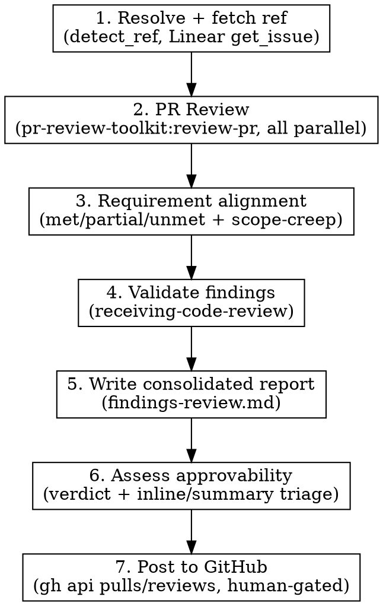

# Review PR

## Overview

Reviews the current diff in this repo — a fresh, self-contained review cycle: resolve and fetch the linked work item (if any) → run `pr-review-toolkit:review-pr` → assess requirement alignment → validate every finding → write a consolidated report → assess approvability and triage findings into inline vs. summary-comment candidates → post the review to GitHub, gated behind your explicit confirmation. Everything the review needs lives in this skill, not in a prompt string handed to another session. With `--since`, the same cycle is a re-review: it also judges your earlier open threads on the PR (Step 4), so none is posted twice.

Differs from `/juel:cmux-review-pr`: that skill spins up an isolated worktree and CMUX workspace and queues this skill as the startup prompt inside it. This skill does the actual reviewing, wherever it runs.

**Announce:** "Using juel:review-pr to review the current diff."

## Strict Execution Protocol (non-negotiable)

<!-- juel:protocol v9 -->

**0. Harness check, before every other rule.** You are running in Codex when you have the `update_plan` tool and no `Skill` tool. Only then read `references/harness-codex.md`, resolved relative to this skill file's own location (`../../references/harness-codex.md`), and apply its construct map, corrected facts, dependency substitutions and degradation contract to every rule below and to every phase body in this skill. This single read is the one action permitted before rule 1's preflight, and only in that case. In every other case, Claude Code without the `TaskCreate` tool included, ignore that file entirely and continue to rule 1.

**1. Preflight, then task list, before anything else.** Before any other output and before any tool call, emit the Preflight block (below). If the preflight verdict is STOP, print the preflight block and **stop** — do not create tasks and do not begin work. Otherwise, before any other work, create one task per phase in this skill's `## Phases` list via `TaskCreate` — `subject` is the phase name, `activeForm` is its present-continuous form. This task list, rendered persistently by the harness, IS the checklist; nothing else satisfies this rule. This is not optional on re-invocation, on resume, or when the user says "just do it".
- **If `TaskCreate`/`TaskUpdate` are not in your tool list, or genuinely fail** — one attempted call returns an error; never assumed unavailable without checking the tool list — use `TodoWrite` when you have it (one todo per phase, the same names, updated at every transition), else an explicit numbered phase log, printed after every phase transition with the same one-line evidence rule 3 already requires. State the degradation once, in one line, before continuing. Never silently swap to prose without saying so.

**2. Phases run in order.** No skipping, reordering, or merging. A phase that does not apply is still announced, not dropped: mark its task `completed` via `TaskUpdate`, with the one-line evidence required by rule 3 stating the skip reason (e.g. "SKIPPED: <reason>") — the task list has no separate "skipped" status, so a skipped phase becomes `completed` too. Never begin phase N+1 before phase N's task is marked `completed`.

**3. Report after every phase.** Mark the phase's task `in_progress` via `TaskUpdate` when starting it, then `completed` via `TaskUpdate` when it finishes or is skipped — each transition accompanied by exactly one line of evidence (path written, command run, count found). Do not re-print the checklist as text; the task list is the persistent record and replaces that. Never claim progress in prose alone.

**4. `review-pr`'s agents run in PARALLEL and FOREGROUND; `code-simplifier` runs FOREGROUND; `codex exec` runs BACKGROUND, WATCHED, and WAITED-ON.** This overrides every other instruction in this file and in any skill invoked from it. Foreground/background is about whether the tool call blocks; watched is about whether output still streams somewhere the user can see it — these are different axes, and `codex exec` needs the second without the first. `review-pr`'s agents additionally need PARALLEL: dispatched together, not one at a time.
- `pr-review-toolkit:review-pr`'s agents MUST be dispatched in parallel: pass `all parallel`, or dispatch the agents together in ONE message. Its sequential default — one agent at a time — is the exact slowness this rule exists to prevent; requesting it, or omitting `all parallel`, is a violation.
- `pr-review-toolkit:review-pr` and `code-simplifier` are foreground-only. When your Agent tool has a `run_in_background` parameter, invoke both with `run_in_background: false` **explicitly** — the harness backgrounds subagents by default, so omitting the flag is a violation, not a neutral choice. Dispatching review-pr's agents in parallel does not relax this: each agent in that one message still carries its own explicit `run_in_background: false`. When your Agent tool has no such parameter, dispatch every one of them together in one message, wait for each one's completion, read each result in full, and check `ListAgents` before treating an idle agent as empty (rule 6); the phase never ends while one is still out. Never `&`. Never `run_in_background: true` for these two. Never "dispatch and continue".
- `codex exec` runs through the **Bash tool**, whose `timeout` parameter is capped at 600000ms (10 minutes). A real `codex exec` applying a plan routinely runs longer than that, so a foreground dispatch gets silently DETACHED by the harness at the cap regardless of this rule — nothing then watches it, nothing reads its output, and the skill would wrongly proceed as if the phase had ended. `review-pr` and `code-simplifier` run through the **Skill/Agent tool**, which carries no such cap — that is the entire reason only `codex exec` changes. Do not "fix" this back to foreground; the cap is a harness fact, not a preference.
- **Always dispatch `codex exec` with `run_in_background: true`** — not optional, not "if it looks long," always. Omitting the flag, or passing `false`, is a violation.
- **Never redirect a command's output to a log file.** No `> out.log`, no `| tee`, no writing output somewhere to read back later. This applies to all three, and is now MORE load-bearing for `codex exec`: backgrounded with no ceiling, the shell is the only place the user watches it work.
- For `review-pr` and `code-simplifier`: read the complete output and state the outcome — finding count, exit status, files changed — before marking the phase done. A summary may follow the raw output; it may never replace it.
- For `codex exec`: wait for it to exit before marking the phase done — backgrounding must never become fire-and-forget. Then state the outcome — exit status, files changed — not a transcript; the user already watched it stream in the shell, so its full output is never printed back into the conversation.
- **Never attach a `Monitor` or a polling loop to `codex exec`.** No `Monitor` armed on its output, no repeated reads of the `.output` file, no `tail -f`. Dispatch it backgrounded and wait for the completion notification — the user already watches it stream in their own shell, which is exactly why output must never be redirected; a watcher on top adds nothing, and a filter with no pattern for `Reading additional input from stdin...` will misread a stalled executor as healthy.
- Passing any of this into another session (a CMUX prompt, a nested `claude`) carries these rules with it — say so explicitly in that prompt string.

**5. Confirmation gates stack; they do not replace this.** Where this skill pauses between phases, the checklist report comes first, then the "Proceed to phase N+1?" question. A user's "yes" advances exactly one phase — it never authorizes skipping ahead or batching the remainder.

**6. `Idling` is a status, not a verdict — never read it as "returned nothing."** When a dispatched `pr-review-toolkit:review-pr` agent or `code-simplifier` shows `Idling` (or any non-streaming status) in the harness's agent view while its call is still in flight, that status alone never means the agent produced no output — `Idling` covers both "still working" and "finished, with a result already available but not yet consumed by this session" indistinguishably. Multi-agent dispatch is exactly where this bites: `pr-review-toolkit:review-pr`'s specialist agents run "all parallel" (rule 4), so several can sit at `Idling` simultaneously while one has already returned and the others haven't.
- **Before concluding a dispatch returned nothing, or re-dispatching it, check `ListAgents` for the agent by name.** If it's listed with a result available, read that result directly — do not wait further and do not re-dispatch a duplicate call.
- **Never re-dispatch `pr-review-toolkit:review-pr` or `code-simplifier` "to unstick it"** without first confirming via `ListAgents` that the original dispatch genuinely produced nothing — re-dispatching a call whose result already exists wastes a full review cycle and risks duplicate, conflicting findings.
- **Never go quiet past a check-in point with no status update.** If a dispatch has been running long enough that you would normally report progress, either report genuine progress or check `ListAgents` first — silently waiting while a subagent is actually done is the exact failure this rule exists to prevent.

## Preflight

| Dep | Type | H/S | Check | If missing |
|---|---|---|---|---|
| pr-review-toolkit | skill | SOFT | ships as a plugin dependency | fall back to `/review`, or an inline review of `git diff <base>...HEAD` |
| superpowers | skill | HARD | ships as a plugin dependency | STOP → `/plugin install superpowers@claude-plugins-official` |
| juel:babysit-pr | skill | SOFT | ships with this plugin | watch the PR by hand |
| Linear MCP | mcp | SOFT | **none — render as `?`** | review proceeds ungraded; the Requirement-alignment section is omitted |
| gh | cli | SOFT | `command -v gh` | ref resolution relies on the branch name alone; review proceeds ungraded if that alone yields nothing. Phase 7 is skipped — the verdict and posting plan from phase 6 are left in the report for manual posting. |
| git repo | context | HARD | `git rev-parse --show-toplevel` | STOP |
| open PR | context | SOFT | `gh pr view $PR_SEL --json number` | phase 7 is skipped — there is no open PR to post to |
| AskUserQuestion | context | SOFT | **none — render as `?`** | phase 7 is skipped — posting never proceeds without interactive confirmation |

## Superpowers skill names

Call each `superpowers:` skill by that name; when the Skill tool answers "Unknown skill", call the same name without the `superpowers:` prefix, and use whichever answered for the rest of the run.

## Phases

This list is the source for `TaskCreate`: one task per phase, `subject` is the phase name, `activeForm` is its present-continuous form, all created before any other work.

1. Resolve the work-item ref and fetch it, or record that there is none and skip grading
2. Run pr-review-toolkit:review-pr, all parallel, FOREGROUND, read the complete output
3. Assess requirement alignment against the fetched work item
4. Validate every finding via superpowers:receiving-code-review
5. Write the consolidated report
6. Assess approval readiness and triage findings for posting
7. Post the review to GitHub, gated behind explicit human confirmation

## Arguments

| Argument | Default | Description |
|----------|---------|-------------|
| `[ref]` | auto-detected — see Step 1 | Work-item reference (e.g. `SAVI-1234` or `#42`) to grade the review against |
| `--pr <n or url>` | the current branch's PR | Review this PR. The checkout's `HEAD` must be the PR's `headRefOid`, or Step 1 stops with "check out the PR head first" |
| `--since <sha>` | none | A re-review: the review agents get the commits `<sha>..HEAD` as their scope (Step 2). When `<sha>` is not an ancestor of `HEAD` (a force-push), the whole PR diff is reviewed and the evidence line says so |
| `--from-babysit` | off | Set by `juel:babysit-pr`'s reviewer mode. Step 7 hands off to nothing, a moved head ends Step 7 instead of only stopping it, and the last line is a `REVIEW-PR` result line (Steps 1 and 7) |

Usage: `/juel:review-pr`, `/juel:review-pr SAVI-1234`, or, from `juel:babysit-pr`'s reviewer mode,
`/juel:review-pr --pr 412 --since 4f2a1c9 --from-babysit`.

## Workflow



### Step 1: Resolve and fetch the work-item ref

**Always operate on the diff and PR state as they exist right now.** Never assume a diff or finding
set read earlier in this conversation, or in a prior invocation, is still current — re-fetch. Step 2
already does this by construction (it dispatches a fresh review every time); this states it
explicitly so a future edit can't quietly reintroduce a cached-diff assumption.

**Resolve the PR.** `PR_SEL` is the `--pr` value, or empty for the current branch's PR. Every
`gh pr view` in this skill passes it:

```bash
PR_SEL='<the --pr value, or empty>'
PR=$(gh pr view $PR_SEL --json number --jq '.number' 2>/dev/null)
PR_HEAD=$(gh pr view $PR_SEL --json headRefOid --jq '.headRefOid' 2>/dev/null)
PR_AUTHOR=$(gh pr view $PR_SEL --json author --jq '.author.login' 2>/dev/null)
ME=$(gh api user --jq '.login' 2>/dev/null)
printf 'pr=%s head=%s author=%s me=%s checkout=%s\n' "$PR" "$PR_HEAD" "$PR_AUTHOR" "$ME" "$(git rev-parse HEAD)"
```

Shell variables do not survive between Bash calls: later commands write these values in literally.
With `--pr`, an empty `PR` (no such PR, or no `gh`) stops the review with "no PR <the --pr value>",
and a checkout that is not `PR_HEAD` stops it with "check out the PR head first (`gh pr checkout
<PR>`)". A stop marks every remaining phase `completed` with "SKIPPED: stopped in step 1". Under
`--from-babysit` the last line is then `REVIEW-PR stopped reason=<the stop message>`. Without
`--pr`, an empty `PR` only means there is no open PR: the review goes on, as below.

If `[ref]` was supplied as an argument, use it directly — skip detection entirely. Otherwise resolve
it via `detect_ref` — anchored to whole `/`-delimited segments with a denylist of generic
branch-type words (never a loose substring match), the same shared helper `juel:start` and
`juel:cmux-review-pr` inline. Try the current branch name first, then the current branch's open PR
title:

```bash
branch=$(git rev-parse --abbrev-ref HEAD 2>/dev/null)
title=$(gh pr view $PR_SEL --json title --jq='.title' 2>/dev/null)

DENY='^(feat|fix|chore|refactor|docs|test|hotfix|release|wip|perf|build|ci|style|v|part|step|pr|review|backup|bugfix|day|demo|draft|new|old|phase|poc|revert|spike|sprint|sync|task|temp|tmp|update|week)$'

_ref_from_segment() {
  seg=$1
  case "$seg" in
    *-*) : ;;
    *) return 1 ;;
  esac
  prefix=${seg%%-*}
  rest=${seg#*-}
  case "$rest" in
    *-*) num=${rest%%-*} ;;
    *)   num=$rest ;;
  esac
  lc_prefix=$(printf '%s' "$prefix" | tr 'A-Z' 'a-z')
  case "$lc_prefix" in
    issue|issues)
      case "$num" in
        ''|*[!0-9]*) return 1 ;;
      esac
      printf '#%s\n' "$num"
      return 0
      ;;
  esac
  case "$prefix" in
    *[!A-Za-z]*) return 1 ;;
  esac
  [ "${#prefix}" -ge 2 ] || return 1
  case "$num" in
    ''|*[!0-9]*) return 1 ;;
  esac
  if printf '%s\n' "$lc_prefix" | grep -Eq "$DENY"; then
    return 1
  fi
  uc_prefix=$(printf '%s' "$prefix" | tr 'a-z' 'A-Z')
  printf '%s-%s\n' "$uc_prefix" "$num"
  return 0
}

detect_ref() {
  str=$1; pat=${2:-}
  result=$(printf '%s\n' "$str" | tr '/' '\n' | while IFS= read -r seg; do
    if ref=$(_ref_from_segment "$seg") && [ -n "$ref" ]; then
      if [ -n "$pat" ]; then
        printf '%s\n' "$ref" | grep -Eq "$pat" || continue
      fi
      printf '%s\n' "$ref"
      break
    fi
  done)
  [ -n "$result" ] && { printf '%s\n' "$result"; return 0; }
  return 1
}

REF=$(detect_ref "$branch") || {
  # PR titles aren't pre-segmented by '/' the way branch names are, and free-form prose must
  # NEVER be fed to detect_ref's segment matcher wholesale: DENY enumerates branch-type words
  # (feat, chore, release, ...), not general technical vocabulary, so converting every space to
  # a '/' delimiter would let ordinary titles leak phantom refs — "Fix UTF-8 handling" -> UTF-8,
  # "Upgrade to Node-18" -> NODE-18, "Add OAuth-2 support" -> OAUTH-2. Instead, extract ONLY the
  # tag span from a leading "[...]" or "type(...)" conventional-commit scope (e.g.
  # "[SAVI-1343] Fix login redirect bug" -> "SAVI-1343"; "feat(SAVI-1343): fix login" ->
  # "SAVI-1343") and run detect_ref on that span alone — text outside the tag is never
  # segmented at all. detect_ref's own algorithm and DENY list (above) are untouched by this
  # narrowing; the normalization lives entirely outside the shared function.
  tag=$(printf '%s' "$title" | sed -n 's/^\[\([^]]*\)\].*/\1/p')
  [ -n "$tag" ] || tag=$(printf '%s' "$title" | sed -n 's/^[A-Za-z]*(\([^)]*\)).*/\1/p')
  if [ -n "$tag" ]; then
    title_norm=$(printf '%s' "$tag" | tr ':' '/')
    REF=$(detect_ref "$title_norm") || REF=""
  else
    REF=""
  fi
}
```

If `REF` is non-empty, fetch it via the Linear MCP `get_issue` for `$REF` and read its requirements
and acceptance criteria — treat them as the spec this diff must satisfy. If `REF` is empty, or the
fetch fails, or the item is not found, skip work-item grading entirely and note that in the report.
**Never block the review on a missing or unfetchable ref** — proceed straight to Step 2 either way.

**Your earlier threads on this PR.** When `PR` is set and `gh` works, fetch every review thread on
the PR and keep the unresolved ones whose first comment is yours. These are the **prior threads**:
Step 4 judges each one, Step 6 never posts one again, and Step 7 replies on them or resolves them.

```bash
PR='<PR from above>'
ME=$(gh api user --jq '.login')
REPO=$(gh repo view --json nameWithOwner --jq '.nameWithOwner')
gh api graphql --paginate -f owner="${REPO%/*}" -f name="${REPO#*/}" -F number="$PR" \
  -f query='query($owner: String!, $name: String!, $number: Int!, $endCursor: String) {
    repository(owner: $owner, name: $name) {
      pullRequest(number: $number) {
        reviewThreads(first: 100, after: $endCursor) {
          pageInfo { hasNextPage endCursor }
          nodes {
            id isResolved isOutdated path line
            comments(first: 100) { nodes { databaseId author { login } body createdAt } }
          }
        }
      }
    }
  }' \
  --jq ".data.repository.pullRequest.reviewThreads.nodes[] | select(.isResolved == false and .comments.nodes[0].author.login == \"$ME\")"
```

Read its output in full. It is one JSON object per prior thread, holding:

- the thread's `id`, which Step 7 resolves by;
- its `path` and `line`;
- its comments. The first one's `databaseId` is the comment Step 7 replies to.

No output means no prior threads: say so in one line and go on. A failed call goes in the phase's
evidence line and counts as no prior threads. It never blocks the review.

### Step 2: Run pr-review-toolkit:review-pr

```
Skill("pr-review-toolkit:review-pr", args: "all parallel", run_in_background: false)
```

Require `all parallel` mode so the review agents dispatch together instead of one at a time. Read
the entire review output and state the finding count before proceeding to Step 3. Capture every
finding — file, line, severity, claim, suggested fix — nothing summarized away yet.

**A re-review (`--since <sha>`).** Check that the commit is here and is an ancestor of `HEAD`:

```bash
SINCE='<the --since value>'
git cat-file -e "$SINCE^{commit}" && git merge-base --is-ancestor "$SINCE" HEAD && echo ancestor
```

When it prints `ancestor`, pass the scope with the mode, in place of the call above:

```
Skill("pr-review-toolkit:review-pr", args: "all parallel. Re-review: review only the changes in git diff <SINCE>..HEAD; the rest of the PR diff is context, not scope.", run_in_background: false)
```

Otherwise the commit is not here, or it is not an ancestor (a force-push). Run the plain call above
on the whole PR diff, and put "<SINCE> is not an ancestor of HEAD: reviewed the whole PR diff" in
the phase's evidence line. Either way, an inline comment still needs a line inside the full PR diff
(Step 6).

**Capture the head commit this review is actually reviewing.**
Under `--pr`, `REVIEWED_COMMIT` is Step 1's `PR_HEAD`. Step 1 proved the checkout is that commit,
so it is the commit the agents read. Do not fetch it again: a push that lands while the agents run
would make a fresh fetch name a head nobody reviewed, and Step 7's guard would then let the review
through. Without `--pr`:

```bash
REVIEWED_COMMIT=$(gh pr view --json headRefOid --jq '.headRefOid' 2>/dev/null)
```

Carry `REVIEWED_COMMIT` forward — Step 5 writes it into the report, and Step 7 compares a fresh
fetch against it before posting. If `gh` is unavailable or this returns empty (no open PR), record
that; Step 7's guard is then a no-op (there's nothing to compare against).

### Step 3: Assess requirement alignment

If a work item was fetched in Step 1, go through each requirement and acceptance criterion
individually and mark it **met** / **partial** / **unmet**, citing the diff evidence that supports
the verdict. Separately, flag anything the diff does that the work item never asked for as
**scope-creep**.

If no work item was fetched (no ref resolved, the fetch failed, or the item was not found), skip
this step's grading — note "no work item — ungraded" for the report — and proceed straight to
Step 4 with the code-quality findings from Step 2.

### Step 4: Validate findings

Invoke the receiving-code-review skill:

```
Skill("superpowers:receiving-code-review")
```

This filters every finding from Step 2 with technical rigor:
- Reject suggestions that are incorrect or unnecessary
- Verify each finding against the actual code before accepting
- Do NOT blindly implement all suggestions

**Reproduce or sabotage-test each finding wherever a running stack makes it feasible** — run the
flagged code path, apply the suggested fix, and confirm behavior actually changes — rather than
confirming by reasoned reading alone. Record the exact command or method used; this becomes the
`Verified via` field Step 5 writes for every Confirmed/Rejected finding. When reproduction genuinely
isn't feasible (no running stack available, or it requires data that can't be constructed), fall
back to reasoned code-reading validation and **say so explicitly** in that finding's `Verified via`
field (e.g. "code reading — no running stack available") — the fallback must be visible, never
indistinguishable from an executed check.

Sort every finding from Step 2 into exactly one of three buckets — **Confirmed**, **Rejected**, or
**Ambiguous** (defined in Step 5). A finding whose validation outcome is unclear is Ambiguous, not
dropped. No finding may go unaccounted for.

**Prior threads.** Judge each prior thread from Step 1 at `HEAD`, with the same rigor, into exactly
one bucket:

- **fixed**: the code at `HEAD` resolves what the thread raised. Name the commit that did it
  (`git log -L <start>,<end>:<path>` over the commits since your review, or the commit in the
  `--since` range that touched those lines).
- **answered**: the author replied with a reason that holds up under the same validation. Say
  why it holds.
- **still open**: not fixed, or the author's reply does not hold. Say why, and judge it
  `blocking: yes` or `blocking: no` by the finding it raised, with Step 6's rule.

An outdated thread (`isOutdated`: its line changed since) is judged like any other. No prior thread
may go unaccounted for.

### Step 5: Write the consolidated report

**Resolve `docsRoot` once, then reuse it.** In order:
1. `config.docsRoot`, if set.
2. `<repo-root>/docs/.superpowers/` **if it exists and is non-empty** — an existing repo keeps
   using the dotted path so prior specs, plans and context are never stranded or split.
3. Otherwise `<repo-root>/docs/superpowers/` — canonical for every new repo.

Never pick between the two variants ad hoc. Layout underneath is
`${docsRoot}/{specs,plans,context,findings,evidence}/`.

```bash
ROOT=$(git rev-parse --show-toplevel)
# Step 1 of the precedence above (config.docsRoot in .claude/workflow.json /
# .claude/workflow.local.json) — if set there, use that value directly
# instead of the filesystem check below. Steps 2-3 (filesystem fallback):
if [ -d "$ROOT/docs/.superpowers" ] && [ -n "$(ls -A "$ROOT/docs/.superpowers" 2>/dev/null)" ]; then
  docsRoot="$ROOT/docs/.superpowers"
else
  docsRoot="$ROOT/docs/superpowers"
fi
```

(If `.claude/workflow.json` or `.claude/workflow.local.json` sets `docsRoot`, that value wins over
the filesystem check above — config always takes precedence.)

Make sure git ignores unanchored `superpowers/` and `.superpowers/` entries, unanchored so they
match at any depth. This directory is scratch, not product. When `git check-ignore -q` says an entry
is not ignored yet, append it to the repo's local exclude file, never to `.gitignore`: a review
must not dirty the branch it reviews, and on someone else's PR a changed `.gitignore` would stop
`juel:babysit-pr`'s reviewer mode on "working tree is dirty" after the very first review.

```bash
EXCLUDE=$(git rev-parse --git-path info/exclude)
mkdir -p "$(dirname "$EXCLUDE")"
for d in superpowers .superpowers; do
  git check-ignore -q "$d/x" || printf '%s/\n' "$d" >> "$EXCLUDE"
done
```

**Never overwrite an existing file under `${docsRoot}`.** On a name collision — a spec, plan,
findings report, or context file that already exists at the derived path — append `-v2` before
the extension; if `-v2` exists too, use `-v3`, and so on. This applies to every file type written
under `${docsRoot}`, not only the one this skill produces.

**Record the reviewed commit at the top of the report, before the sections below** — Step 7
reads this line back to detect whether the PR moved since this review ran:

```markdown
**Reviewed at commit:** `<REVIEWED_COMMIT from Step 2>`
```

Omit this line only when Step 2 recorded no `REVIEWED_COMMIT` (no `gh`, no open PR) — never write an
empty backtick pair.

Write the report to `${docsRoot}/findings/findings-review.md`, or to the next free `-vN` name when
that exists (above), and set `REPORT` to the path actually written. Steps 6 and 7 read and edit
`$REPORT`, never a hard-coded `findings-review.md`: on a second run the file is
`findings-review-v2.md`, and reading the first run's file would compare the wrong commit. It has
exactly five sections, in this order (Step 6 then adds the Good-to-merge line at the top and
appends a sixth):

1. **Requirement-alignment** — each requirement/acceptance criterion from Step 3, marked met /
   partial / unmet with evidence, plus any scope-creep beyond the work item. Omit this section
   entirely (with a one-line note explaining why — no ref, fetch failed, or not found) when there
   is no work item.
2. **Confirmed** — findings from Step 4 that survived validation and are actionable. Each entry
   carries a `Verified via:` field stating the command/method Step 4 used to confirm it (or the
   explicit reasoned-validation fallback note when reproduction wasn't feasible).
3. **Rejected** — findings validation found incorrect or unnecessary, each **with the reason** and
   a `Verified via:` field alongside it, same as Confirmed.
4. **Ambiguous** — findings that could not be settled against the diff and need the user's
   judgment. Exempt from `Verified via` by definition — nothing was settled to record a method for.
5. **Prior threads**: each prior thread from Step 1, with its location (`path:line`), the point it
   raised in one line, its thread `id`, its first comment's `databaseId`, and its bucket from
   Step 4: **fixed** (with the commit), **answered** (with why), or **still open** (with why, and
   `blocking: yes` or `blocking: no`). With no prior threads, this section is one line saying so.

**Every finding captured in Step 2 must appear in exactly one of Confirmed / Rejected / Ambiguous —
state this explicitly in the report.** Silently dropping a finding between Step 2 and the report is
this plugin's most recurrent defect class; a reader of the report must be able to verify the count
in equals the count out. Every prior thread from Step 1 appears exactly once under Prior threads,
the same way.

### Step 6: Assess approval readiness and triage postable findings

Using the Requirement-alignment, Confirmed, Ambiguous and Prior threads sections written in Step 5, decide a
**verdict** and split the postable content into an **inline** list and a **summary body**. This
step never touches GitHub — it only produces the draft that Step 7 later posts, or that stays in
the report for manual posting.

**Blocking or not.** Mark every Confirmed finding `blocking: yes` or `blocking: no` in the report,
the way Step 4 already marked each prior thread still open:

- **Blocking**: merging as it stands would cause harm. A reachable correctness defect, a security
  issue, data loss or corruption, a broken build or test, a regression of existing behaviour, or
  an unmet acceptance criterion.
- **Non-blocking**: anything a follow-up can carry. Style, simplification, an edge case with no
  realistic trigger, a missing test for behaviour that already works.

**Verdict.** It answers one question: is this PR good to merge as it stands? Apply these rules in
order, stop at the first match:

1. Any blocking Confirmed finding, any Requirement-alignment item that is **unmet**, or any prior
   thread still open with `blocking: yes` → `REQUEST_CHANGES`.
2. Any Ambiguous finding that would block if it were confirmed → `COMMENT`.
3. Otherwise → `APPROVE`. Non-blocking findings go out as the approval's comments, inline or in
   the summary as triaged below.

A Requirement-alignment item that is **partial** counts as unmet when what is missing is the
criterion's own behaviour, and as non-blocking when only a detail around it is missing. Say which
in its line.

State the one-line rule that produced the verdict (e.g. "REQUEST_CHANGES: Confirmed finding at
`src/auth.py:42` is a blocking correctness defect").

**Good to merge.** Then write the answer at the top of `$REPORT`, on the line after
`**Reviewed at commit:**` (its first line when there is none):

```markdown
**Good to merge:** yes. <one sentence>
```

when the verdict is `APPROVE`, else:

```markdown
**Good to merge:** no. <one sentence naming what blocks, or what must be settled first>
```

It is yes exactly when the verdict is `APPROVE`. When someone asks whether the PR is good to merge,
this line is the answer, and the verdict can never disagree with it.

**Never post a prior thread twice.** A Confirmed finding that matches a prior thread still open is
neither inline nor in the summary. A match means the same file, the thread's line inside the
finding's range, and the same defect. Its thread goes in the **Thread replies** table instead, with
the body `Still open at <short sha>: <why>`. A prior thread still open with no matching finding gets
the same reply. Every prior thread Step 4 judged **fixed** or **answered** goes in the
**Threads to resolve** table, with `fixed in <short sha>` or the accepted answer as its reason.

**Inline vs. summary triage** — for every Confirmed finding the rule above did not route to a thread reply:

- **Inline** when it has a concrete `file` and `line`, and that line falls within the PR's diff
  (a line that changed, or sits inside a diff hunk). GitHub's review API rejects comments anchored
  outside the diff, so a finding that cannot be placed this way is never queued as inline — route
  it to the summary instead.
- **Summary** when it lacks a precise `file`/`line` anchor, references a line outside the diff, or
  is a cross-cutting/architectural observation that reads better as prose than as a line comment.

Every Ambiguous finding goes into the summary as an open question for the human to resolve — never
posted inline, since it is by definition unresolved. Note the count of Rejected findings in one
summary line (not their detail) so nothing is silently dropped from the record, without spamming
the PR with dismissed nitpicks.

Append a sixth section to the same `$REPORT` file Step 5 wrote. Do not create a second file:

```markdown
## Verdict & posting plan

**Verdict:** APPROVE | REQUEST_CHANGES | COMMENT — <the one-line rule that produced it>

**Summary body** (goes into the GitHub review's `body` field):

<markdown text: verdict rationale, requirement-alignment recap if graded, non-inline Confirmed
findings, Ambiguous findings as open questions, one-line Rejected-count footer>

**Inline comments** (goes into the GitHub review's `comments[]` field):

| File | Line | Body |
|---|---|---|
| path/to/file.py | 42 | <finding claim + suggested fix> |

**Threads to resolve** (resolved after the review posts, Step 7):

| Thread | Location | Why |
|---|---|---|
| <thread node id> | path/to/file.py:42 | fixed in <short sha> |

**Thread replies** (posted after the review, Step 7):

| Thread | Reply to | Body |
|---|---|---|
| <thread node id> | <first comment databaseId> | Still open at <short sha>: <why> |
```

If there are zero inline-worthy findings, the table has a header and no rows — never omit the
table itself. The two thread tables follow the same rule. If Confirmed is empty and no work item was graded, or every requirement is met with
no blocking findings, the verdict is `APPROVE` with an empty inline table.

### Step 7: Post the review to GitHub (human-gated)

**This step never posts without an explicit "yes" from the user in this turn.** No prior
confirmation (from an earlier phase, an earlier run, or an argument) satisfies this — the gate is
per-invocation.

Skip this step entirely, marking its task `completed` with a one-line "SKIPPED: <reason>", when
any of the following hold — check in order:

1. `gh` is not installed → "SKIPPED: gh not installed".
2. There is no open PR to post to (`gh pr view $PR_SEL --json number` fails) → "SKIPPED: no open PR".
3. This session cannot ask the user anything (no interactive user) → "SKIPPED: non-interactive session".

None of these block the skill overall — Step 6's verdict and posting plan already live in
`$REPORT` for the user to post by hand. Under `--from-babysit`, a skip ends with the last line
`REVIEW-PR stopped reason=<the SKIPPED reason>`.

Otherwise, resolve the repo, PR number, and head commit:

```bash
REPO=$(gh repo view --json nameWithOwner --jq '.nameWithOwner')
PR_SEL='<the --pr value, or empty>'
PR=$(gh pr view $PR_SEL --json number --jq '.number')
COMMIT=$(gh pr view $PR_SEL --json headRefOid --jq '.headRefOid')
```

**Stale-head-SHA guard.** Re-read the commit this review actually reviewed from `$REPORT`, the
report Step 5 wrote:

```bash
REPORT='<the report path Step 5 wrote>'
REVIEWED_COMMIT=$(sed -n 's/^\*\*Reviewed at commit:\*\* `\([^`]*\)`.*/\1/p' "$REPORT" | head -1)
```

If `REVIEWED_COMMIT` is non-empty and differs from the fresh `COMMIT` fetched above: **do not
post.** Report to the user that the PR's head moved from `$REVIEWED_COMMIT` to `$COMMIT` since the
review ran (state the commit count between them via `git rev-list --count
$REVIEWED_COMMIT..$COMMIT` if the ref is locally available, otherwise state the two SHAs), and that
findings may be anchored to lines that no longer exist in the new diff. Mark the task `completed`
with that evidence and stop this step here — do not proceed to the confirmation question below.
Re-running `review-pr` from Step 2 is the user's decision, never auto-triggered. Under
`--from-babysit` the step ends instead with the last line
`REVIEW-PR head-moved from=<REVIEWED_COMMIT> to=<COMMIT>`, and babysit runs the review again once
the new head has settled. If
`REVIEWED_COMMIT` is empty (Step 2 recorded none) or matches `COMMIT`, continue below unchanged.

Present the full draft to the user: the Good-to-merge line, the verdict, the summary body, the
inline comment table, and the two thread tables from Step 6. Then ask both questions in one call.
The draft's verdict is the first option of the first question, and
the other two follow in the order APPROVE, REQUEST_CHANGES, COMMENT:

```
AskUserQuestion({questions: [
  {
    question: "Which verdict should this review carry?",
    header: "Verdict",
    multiSelect: false,
    options: [
      {label: "<the draft verdict> (Recommended)", description: "The verdict Step 6 drew: <its one-line rule>."},
      {label: "<the next verdict>", description: "<its description below>"},
      {label: "<the last verdict>", description: "<its description below>"}
    ]
  },
  {
    question: "Post this review to the PR?",
    header: "Post review",
    multiSelect: false,
    options: [
      {label: "Post now", description: "Submit the review with the verdict above, then the thread replies, then resolve the threads listed."},
      {label: "Edit first", description: "Revise the verdict, summary, comments, replies or threads to resolve before posting."},
      {label: "Don't post", description: "Leave the draft in the report; nothing is sent to GitHub."}
    ]
  }
]})
```

The descriptions of the two options that are not the draft's verdict:

- `APPROVE`: "Approve: nothing blocks merging; non-blocking findings go out as comments."
- `REQUEST_CHANGES`: "Request changes: the author must address the blocking findings before merging."
- `COMMENT`: "Comment only: neither approve nor block."

The answers:

- **"Edit first"**: revise what the user asks for, update the `## Verdict & posting plan` section
  of `$REPORT` to match, then present it and ask both questions again. Never post on this branch
  without a later "Post now".
- **"Don't post"**: mark the task `completed` with "SKIPPED: user declined to post". Under
  `--from-babysit`, end with the last line `REVIEW-PR not-posted head=<COMMIT>`. Stop.
- **"Post now"**: the verdict is the one the user chose. When it is not the draft's, rewrite the
  report's `**Verdict:**` line to it, with "(chosen by the user at post time over <the draft
  verdict>)". Rewrite its `**Good to merge:**` line to match: yes exactly when the chosen verdict
  is `APPROVE`. Continue below.

Build the request body and write it to a temp file with the **Write tool — never a HEREDOC**
(same rule as `ship-ticket`'s PR body: AI-generated text in a shell heredoc risks breaking on
backticks/`$`/quotes in the finding text):

```json
{
  "commit_id": "<COMMIT>",
  "body": "<the summary body from Step 6>",
  "event": "<the verdict chosen in the Verdict question: APPROVE | REQUEST_CHANGES | COMMENT>",
  "comments": [
    { "path": "<file>", "line": <line>, "side": "RIGHT", "body": "<finding text>" }
  ]
}
```

`comments` is `[]` when Step 6's inline table has no rows — GitHub accepts an empty array with a
populated `body`.

Submit it:

```bash
PAYLOAD=/path/to/temp/file.json   # written via the Write tool above
RESPONSE=$(gh api "repos/$REPO/pulls/$PR/reviews" --input "$PAYLOAD" 2>&1)
STATUS=$?
```

**Self-approval:** if `STATUS` is non-zero, the verdict was `APPROVE`, and `$RESPONSE` contains
"own pull request" — GitHub blocks approving your own PR. Rewrite the payload with
`"event": "COMMENT"` and prefix `body` with `**Verdict: would APPROVE** (GitHub blocks
self-approval on your own PR — posted as a comment instead)\n\n`, then retry the same `gh api`
call **once**. Never silently downgrade the verdict without saying so in the posted body.

**Any other failure:** do not retry. Report the exact `gh api` error and the payload file's path
in the phase's evidence line, mark the task `completed` with that evidence, and stop — the draft
remains in `$REPORT` for the user to post by hand or hand back to this step. This is a
GitHub API boundary; swallowing the error here would hide exactly the kind of failure (a line
outside the diff, an expired token, a closed PR) the user needs to see. Under `--from-babysit`,
end with the last line `REVIEW-PR stopped reason=gh api: <the error's first line>`.

**On success:** extract the review URL from `$RESPONSE`:

```bash
REVIEW_URL=$(printf '%s' "$RESPONSE" | sed -n 's/.*"html_url" *: *"\([^"]*\)".*/\1/p' | head -1)
```

Append one line to the `## Verdict & posting plan` section of `$REPORT`, the file Step 6 already
edited. Edit that file; never create a second one:

```markdown
**Posted:** <REVIEW_URL>
```

State the review URL and verdict back to the user as the phase's evidence.

**Thread replies, then threads to resolve.** These run only after the review posted. For each row
of the **Thread replies** table, write its body to a temp file with the Write tool, then reply on
the thread's first comment:

```bash
gh api -X POST "repos/<REPO>/pulls/<PR>/comments/<the row's Reply to>/replies" -F body=@<tmpfile>
```

For each row of the **Threads to resolve** table:

```bash
gh api graphql -f threadId='<the row thread id>' \
  -f query='mutation($threadId: ID!) { resolveReviewThread(input: {threadId: $threadId}) { thread { isResolved } } }'
```

A reply or resolve that fails is reported with its exact error and is not retried. The rest still
run, and the posted review stands. Append to the `## Verdict & posting plan` section of `$REPORT`:

```markdown
**Thread replies posted:** <n of m>
**Threads resolved:** <n of m>
```

followed by one line per failure, naming the thread and the error.

**Under `--from-babysit`,** the last line is
`REVIEW-PR posted verdict=<the event that posted> commit=<COMMIT> url=<REVIEW_URL>`. The event is
`COMMENT` when the self-approval fallback ran. The step ends there.

**Otherwise, hand off to reviewer mode** when both hold:

- the posted event is not `APPROVE`;
- the PR is not yours: `PR_AUTHOR` from Step 1 is not `ME`.

Mark this step `completed`, say "Watching PR #<PR> for the author's response", then
invoke `/juel:babysit-pr <PR>`. On a PR you did not author it runs its reviewer mode: it waits for
the author, then runs this skill again. An `APPROVE`, a review of your own PR, or "Don't post"
hands off nothing.

## Edge cases

| Situation | Action |
|-----------|--------|
| `[ref]` argument supplied | Use it directly; skip Step 1's `detect_ref` entirely |
| No ref in branch name or PR title | Review proceeds ungraded; Requirement-alignment section omitted with a one-line note. Do not block. |
| PR title has a ref with no surrounding `[...]`/`type(...)` tag (e.g. bare `SAVI-1343 Fix login`, no brackets) | Known limitation: the title fallback only extracts from a bracket or conventional-commit-scope span, deliberately, to avoid segmenting free-form prose. Falls through to "no ref" unless the branch name already carried it — branch is tried first and usually does. |
| `gh` not installed or no PR open for the current branch | Title fallback is skipped; ref resolution relies on the branch name alone |
| Ref resolved but Linear `get_issue` fails / not found | Proceed with code review only; Requirement-alignment section records the fetch failure instead of grading |
| `pr-review-toolkit` not installed | Fall back to `/review`, or an inline review of `git diff <base>...HEAD` |
| Zero findings from Step 2 | Confirmed / Rejected / Ambiguous sections are all empty; still write the report and say so explicitly — do not skip the report |
| All findings rejected | Still write the report with an empty Confirmed section; do not suppress the file |
| `${docsRoot}/findings/` does not exist yet | Create it (`mkdir -p`) before writing the report |
| Existing `findings-review.md` from a prior run | Never overwrite it. Write `findings-review-v2.md` instead; if that exists too, `-v3`, and so on — same versioning rule as every other file under `${docsRoot}`. Steps 6 and 7 then use the file actually written (`$REPORT`) |
| Confirmed finding has no `file`/`line`, or references a line outside the PR's diff | Goes to the summary body, never the inline table — GitHub rejects inline comments anchored outside the diff |
| No Confirmed or Ambiguous findings, and all graded requirements are met (or ungraded) | Verdict is `APPROVE` with an empty inline table |
| Zero inline-worthy findings but a non-empty summary | Still post — `comments: []` with a populated `body` is valid |
| `gh` not installed when Step 7 runs | Step 7 is skipped; the verdict and posting plan stay in the report for manual posting |
| No open PR for the current branch when Step 7 runs | Step 7 is skipped; note "no PR to post to" |
| Non-interactive session (no way to ask the user) | Step 7 is skipped; posting never proceeds without confirmation |
| User chooses "Don't post" | Step 7 task is completed as "SKIPPED: user declined to post"; nothing is sent to GitHub |
| `event: APPROVE` rejected because it is the user's own PR | Retry once as `COMMENT`, with the body prefixed noting GitHub blocked self-approval |
| Any other `gh api` failure (e.g. a line outside the diff) | Do not retry; report the exact error and the payload file path; nothing is silently swallowed |
| `--pr` given and `HEAD` is not the PR's head | Step 1 stops with "check out the PR head first"; under `--from-babysit`, the last line is `REVIEW-PR stopped reason=<the stop message>` |
| `--since` commit not here, or not an ancestor of `HEAD` (a force-push) | Review the whole PR diff and say so in Step 2's evidence line |
| No prior threads, or the threads query fails | Prior threads is one line saying so; the review goes on |
| A Confirmed finding matches a prior thread still open | Not posted again; the thread gets a `Still open at <short sha>` reply |
| The user picks a verdict other than the draft's | The report's Verdict and Good-to-merge lines follow the chosen verdict |
| A thread reply or resolve fails | Report its error, no retry; the rest still run and the posted review stands |
| A posted review that is not APPROVE, on someone else's PR | Hand off to `/juel:babysit-pr <PR>` (reviewer mode), unless `--from-babysit` |
| A moved head under `--from-babysit` | Post nothing; the last line is `REVIEW-PR head-moved from=<REVIEWED_COMMIT> to=<COMMIT>` |
